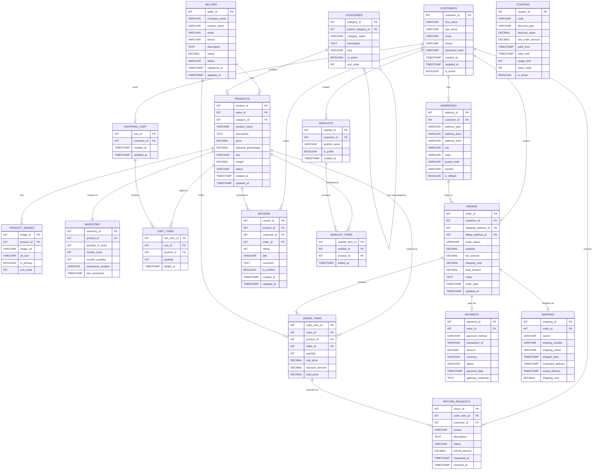

# ShopEase — Entity-Relationship Diagram

## Overview

This ER diagram models the complete data architecture for ShopEase, an online e-commerce platform. The diagram captures **18 entities** spanning customer management, product cataloguing, order processing, payment handling, shipping logistics, reviews, and inventory management.

### Cardinality Notation

| Symbol | Meaning |
|--------|---------|
| `\|\|` | Exactly one |
| `o\|` | Zero or one |
| `\|{` | One or more |
| `o{` | Zero or more |

---

## Entity-Relationship Diagram

---

## Relationship Summary

### One-to-Many (1:M) Relationships

| Parent Entity | Child Entity | Description |
|---------------|-------------|-------------|
| CUSTOMERS | ADDRESSES | A customer can have multiple addresses (home, work, etc.) |
| CUSTOMERS | ORDERS | A customer can place multiple orders over time |
| CUSTOMERS | REVIEWS | A customer can write reviews for multiple products |
| CUSTOMERS | WISHLISTS | A customer can maintain multiple wishlists |
| CUSTOMERS | RETURN_REQUESTS | A customer can submit multiple return requests |
| SELLERS | PRODUCTS | A seller/vendor can list multiple products |
| SELLERS | ORDER_ITEMS | A seller fulfils multiple order line items |
| CATEGORIES | PRODUCTS | A category contains multiple products |
| CATEGORIES | CATEGORIES | A category can have multiple subcategories (self-referencing) |
| PRODUCTS | PRODUCT_IMAGES | A product can have multiple images/gallery photos |
| PRODUCTS | CART_ITEMS | A product can appear in multiple carts |
| PRODUCTS | ORDER_ITEMS | A product can be part of multiple orders |
| PRODUCTS | REVIEWS | A product can receive multiple reviews |
| PRODUCTS | WISHLIST_ITEMS | A product can appear in multiple wishlists |
| SHOPPING_CART | CART_ITEMS | A cart contains multiple items |
| ORDERS | ORDER_ITEMS | An order contains multiple line items |
| WISHLISTS | WISHLIST_ITEMS | A wishlist contains multiple items |
| ADDRESSES | ORDERS | An address can be used for multiple orders |

### One-to-One (1:1) Relationships

| Entity A | Entity B | Description |
|----------|----------|-------------|
| CUSTOMERS | SHOPPING_CART | Each customer has at most one active cart |
| PRODUCTS | INVENTORY | Each product has exactly one inventory record |
| ORDERS | PAYMENTS | Each order has at most one payment record |
| ORDERS | SHIPPING | Each order has at most one shipping record |
| ORDER_ITEMS | RETURN_REQUESTS | Each order item can have at most one return request |

### Many-to-Many (M:N) Relationships (via Junction Tables)

| Entity A | Entity B | Junction Table | Description |
|----------|----------|---------------|-------------|
| SHOPPING_CART | PRODUCTS | CART_ITEMS | Products added to shopping carts |
| ORDERS | PRODUCTS | ORDER_ITEMS | Products included in orders |
| WISHLISTS | PRODUCTS | WISHLIST_ITEMS | Products saved to wishlists |

---

## Design Decisions

1. **Self-referencing Categories**: The `CATEGORIES` table uses a `parent_category_id` foreign key to support unlimited nesting depth (e.g., Electronics → Phones → Smartphones).

2. **Separate Address Table**: Addresses are normalised into their own table to support multiple addresses per customer and to allow both shipping and billing addresses on orders.

3. **Junction Tables for M:N**: `CART_ITEMS`, `ORDER_ITEMS`, and `WISHLIST_ITEMS` serve as junction/associative tables, each carrying additional attributes (quantity, price, timestamps).

4. **Seller on ORDER_ITEMS**: The `seller_id` on `ORDER_ITEMS` (rather than only on `ORDERS`) supports marketplace-style multi-seller orders where different items are fulfilled by different sellers.

5. **Coupons Entity**: Included to model promotional discounts with usage limits, validity windows, and both percentage and fixed-amount discount types.

6. **Return Requests at Item Level**: Returns are modelled at the `ORDER_ITEMS` level (not the order level) to support partial returns where only some items in an order are returned.
