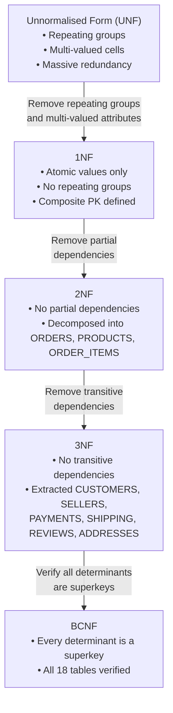

# ShopEase — Normalisation Analysis

## 1. Introduction

Normalisation is the systematic process of organising a relational database to reduce data redundancy and eliminate undesirable insertion, update, and deletion anomalies. This document demonstrates the normalisation process applied to the ShopEase e-commerce platform, progressing from an unnormalised form (UNF) through First Normal Form (1NF), Second Normal Form (2NF), Third Normal Form (3NF), and finally Boyce-Codd Normal Form (BCNF).

We will use the **Orders** domain as the primary example, as it is the most complex area of the schema and best illustrates the normalisation challenges.

---

## 2. Unnormalised Form (UNF)

In a naive, unnormalised design, all order-related data might be stored in a single flat table:

### ORDERS_UNNORMALISED

| order_id | order_date | customer_name | customer_email | customer_phone | shipping_address | billing_address | product_names | product_skus | quantities | unit_prices | seller_names | seller_emails | payment_method | payment_status | transaction_id | tracking_number | carrier | shipping_status | review_ratings | review_comments |
|----------|-----------|---------------|----------------|----------------|-----------------|-----------------|---------------|-------------|-----------|------------|-------------|--------------|----------------|---------------|----------------|-----------------|---------|-----------------|----------------|-----------------|
| 1001 | 2024-01-15 | Alice Smith | alice@email.com | 555-0101 | 10 Oak St, London, UK | 10 Oak St, London, UK | Laptop, Mouse | SKU-001, SKU-002 | 1, 2 | 899.99, 29.99 | TechStore, TechStore | tech@shop.com, tech@shop.com | Credit Card | Completed | TXN-5001 | TRACK-001 | Royal Mail | Delivered | 5, 4 | Great laptop!, Good mouse |
| 1002 | 2024-01-16 | Bob Jones | bob@email.com | 555-0102 | 25 Elm Ave, Manchester, UK | 30 High St, Manchester, UK | T-Shirt, Jeans, Belt | SKU-010, SKU-011, SKU-012 | 3, 1, 1 | 19.99, 49.99, 24.99 | FashionHub, FashionHub, LeatherCo | fashion@shop.com, fashion@shop.com, leather@shop.com | PayPal | Completed | TXN-5002 | TRACK-002 | DPD | In Transit | NULL, NULL, NULL | NULL, NULL, NULL |

### Problems with UNF

1. **Repeating groups**: `product_names`, `quantities`, `unit_prices`, etc. contain comma-separated lists — multiple values in a single cell.
2. **Data redundancy**: Customer information (`customer_name`, `customer_email`) is repeated for every order by the same customer; seller information is duplicated across items.
3. **Insertion anomaly**: Cannot add a new product or customer without creating an order.
4. **Update anomaly**: If a customer changes their email, it must be updated in every row for that customer.
5. **Deletion anomaly**: Deleting the only order for a customer loses all customer information.

---

## 3. First Normal Form (1NF)

**Rule**: A relation is in 1NF if and only if:
- All attributes contain only atomic (indivisible) values
- There are no repeating groups
- Each row is uniquely identifiable (has a primary key)

### Transformation

We eliminate repeating groups by creating one row per order-item combination. Each cell now holds a single atomic value.

### ORDERS_1NF

| order_id | order_date | customer_name | customer_email | customer_phone | shipping_addr_line | shipping_city | shipping_country | billing_addr_line | billing_city | billing_country | product_name | product_sku | quantity | unit_price | seller_name | seller_email | payment_method | payment_status | transaction_id | tracking_number | carrier | shipping_status | review_rating | review_comment |
|----------|-----------|---------------|----------------|----------------|--------------------|---------------|------------------|-------------------|--------------|-----------------|-------------|------------|----------|-----------|-------------|-------------|----------------|---------------|----------------|-----------------|---------|-----------------|--------------|----------------|
| 1001 | 2024-01-15 | Alice Smith | alice@email.com | 555-0101 | 10 Oak St | London | UK | 10 Oak St | London | UK | Laptop | SKU-001 | 1 | 899.99 | TechStore | tech@shop.com | Credit Card | Completed | TXN-5001 | TRACK-001 | Royal Mail | Delivered | 5 | Great laptop! |
| 1001 | 2024-01-15 | Alice Smith | alice@email.com | 555-0101 | 10 Oak St | London | UK | 10 Oak St | London | UK | Mouse | SKU-002 | 2 | 29.99 | TechStore | tech@shop.com | Credit Card | Completed | TXN-5001 | TRACK-001 | Royal Mail | Delivered | 4 | Good mouse |
| 1002 | 2024-01-16 | Bob Jones | bob@email.com | 555-0102 | 25 Elm Ave | Manchester | UK | 30 High St | Manchester | UK | T-Shirt | SKU-010 | 3 | 19.99 | FashionHub | fashion@shop.com | PayPal | Completed | TXN-5002 | TRACK-002 | DPD | In Transit | NULL | NULL |
| 1002 | 2024-01-16 | Bob Jones | bob@email.com | 555-0102 | 25 Elm Ave | Manchester | UK | 30 High St | Manchester | UK | Jeans | SKU-011 | 1 | 49.99 | FashionHub | fashion@shop.com | PayPal | Completed | TXN-5002 | TRACK-002 | DPD | In Transit | NULL | NULL |
| 1002 | 2024-01-16 | Bob Jones | bob@email.com | 555-0102 | 25 Elm Ave | Manchester | UK | 30 High St | Manchester | UK | Belt | SKU-012 | 1 | 24.99 | LeatherCo | leather@shop.com | PayPal | Completed | TXN-5002 | TRACK-002 | DPD | In Transit | NULL | NULL |

**Composite Primary Key**: `{order_id, product_sku}`

**What changed**:
- Multi-valued attributes split into individual rows ✓
- Address split into atomic components (line, city, country) ✓
- Each cell contains exactly one value ✓

**Remaining problems**: Massive redundancy — customer data, order metadata, payment info, and shipping info repeated on every line item row.

---

## 4. Second Normal Form (2NF)

**Rule**: A relation is in 2NF if and only if:
- It is in 1NF, **and**
- Every non-key attribute is **fully functionally dependent** on the entire primary key (no partial dependencies)

### Functional Dependencies Analysis

With the composite key `{order_id, product_sku}`:

**Partial dependencies** (depend on only part of the key):

| Determinant | Dependent Attributes |
|------------|---------------------|
| `order_id` → | `order_date`, `customer_name`, `customer_email`, `customer_phone`, `shipping_addr_line`, `shipping_city`, `shipping_country`, `billing_addr_line`, `billing_city`, `billing_country`, `payment_method`, `payment_status`, `transaction_id`, `tracking_number`, `carrier`, `shipping_status` |
| `product_sku` → | `product_name`, `seller_name`, `seller_email` |

**Full dependencies** (depend on the whole key):

| Determinant | Dependent Attributes |
|------------|---------------------|
| `{order_id, product_sku}` → | `quantity`, `unit_price`, `review_rating`, `review_comment` |

### Transformation

Remove partial dependencies by decomposing into separate relations:

#### ORDERS_2NF

| order_id (PK) | order_date | customer_name | customer_email | customer_phone | shipping_addr_line | shipping_city | shipping_country | billing_addr_line | billing_city | billing_country | payment_method | payment_status | transaction_id | tracking_number | carrier | shipping_status |
|--------------|-----------|---------------|----------------|----------------|--------------------|---------------|------------------|-------------------|--------------|-----------------|----------------|---------------|----------------|-----------------|---------|-----------------|
| 1001 | 2024-01-15 | Alice Smith | alice@email.com | 555-0101 | 10 Oak St | London | UK | 10 Oak St | London | UK | Credit Card | Completed | TXN-5001 | TRACK-001 | Royal Mail | Delivered |
| 1002 | 2024-01-16 | Bob Jones | bob@email.com | 555-0102 | 25 Elm Ave | Manchester | UK | 30 High St | Manchester | UK | PayPal | Completed | TXN-5002 | TRACK-002 | DPD | In Transit |

#### PRODUCTS_2NF

| product_sku (PK) | product_name | seller_name | seller_email |
|-----------------|-------------|-------------|-------------|
| SKU-001 | Laptop | TechStore | tech@shop.com |
| SKU-002 | Mouse | TechStore | tech@shop.com |
| SKU-010 | T-Shirt | FashionHub | fashion@shop.com |
| SKU-011 | Jeans | FashionHub | fashion@shop.com |
| SKU-012 | Belt | LeatherCo | leather@shop.com |

#### ORDER_ITEMS_2NF

| order_id (PK, FK) | product_sku (PK, FK) | quantity | unit_price | review_rating | review_comment |
|-------------------|---------------------|----------|-----------|--------------|----------------|
| 1001 | SKU-001 | 1 | 899.99 | 5 | Great laptop! |
| 1001 | SKU-002 | 2 | 29.99 | 4 | Good mouse |
| 1002 | SKU-010 | 3 | 19.99 | NULL | NULL |
| 1002 | SKU-011 | 1 | 49.99 | NULL | NULL |
| 1002 | SKU-012 | 1 | 24.99 | NULL | NULL |

**What changed**:
- Partial dependencies removed ✓
- Customer and order metadata stored once per order ✓
- Product and seller data stored once per product ✓

**Remaining problems**: Transitive dependencies still exist (e.g., `order_id → customer_email → customer_name`; `product_sku → seller_name → seller_email`).

---

## 5. Third Normal Form (3NF)

**Rule**: A relation is in 3NF if and only if:
- It is in 2NF, **and**
- No non-key attribute is **transitively dependent** on the primary key (i.e., every non-key attribute depends directly on the primary key, not through another non-key attribute)

### Transitive Dependencies Analysis

#### In ORDERS_2NF:

| Transitive Chain | Attributes Affected |
|-----------------|-------------------|
| `order_id → customer_email → customer_name, customer_phone` | Customer info depends on customer, not on order directly |
| `order_id → transaction_id → payment_method, payment_status` | Payment info depends on transaction, not order directly |
| `order_id → tracking_number → carrier, shipping_status, shipped_date` | Shipping info depends on tracking, not order directly |

#### In PRODUCTS_2NF:

| Transitive Chain | Attributes Affected |
|-----------------|-------------------|
| `product_sku → seller_name → seller_email` | Seller info depends on seller, not product directly |

#### In ORDER_ITEMS_2NF:

| Transitive Chain | Attributes Affected |
|-----------------|-------------------|
| `{order_id, product_sku} → review_rating, review_comment` | Reviews are an independent entity; a customer might review later or not at all |

### Transformation

Decompose to remove transitive dependencies:

#### CUSTOMERS_3NF

| customer_id (PK) | first_name | last_name | email (UNIQUE) | phone | password_hash | is_active | created_at |
|-----------------|-----------|----------|-------|-------|---------------|-----------|-----------|
| 1 | Alice | Smith | alice@email.com | 555-0101 | \<hashed\> | TRUE | 2024-01-01 |
| 2 | Bob | Jones | bob@email.com | 555-0102 | \<hashed\> | TRUE | 2024-01-05 |

#### ADDRESSES_3NF

| address_id (PK) | customer_id (FK) | address_type | address_line1 | city | state | postal_code | country | is_default |
|----------------|-----------------|-------------|---------------|------|-------|-------------|---------|-----------|
| 1 | 1 | shipping | 10 Oak St | London | England | SW1A 1AA | UK | TRUE |
| 2 | 2 | shipping | 25 Elm Ave | Manchester | Greater Manchester | M1 1AA | UK | TRUE |
| 3 | 2 | billing | 30 High St | Manchester | Greater Manchester | M2 2BB | UK | FALSE |

#### SELLERS_3NF

| seller_id (PK) | company_name (UNIQUE) | contact_name | email (UNIQUE) | phone | status | registered_at |
|---------------|---------------------|-------------|-------|-------|--------|--------------|
| 1 | TechStore | Tom Tech | tech@shop.com | 555-0201 | active | 2023-06-01 |
| 2 | FashionHub | Fiona Fashion | fashion@shop.com | 555-0202 | active | 2023-07-15 |
| 3 | LeatherCo | Leo Leather | leather@shop.com | 555-0203 | active | 2023-08-01 |

#### PRODUCTS_3NF

| product_id (PK) | seller_id (FK) | category_id (FK) | product_name | sku (UNIQUE) | price | status | created_at |
|----------------|---------------|-----------------|-------------|-------------|-------|--------|-----------|
| 1 | 1 | 5 | Laptop | SKU-001 | 899.99 | active | 2024-01-01 |
| 2 | 1 | 5 | Mouse | SKU-002 | 29.99 | active | 2024-01-01 |
| 3 | 2 | 8 | T-Shirt | SKU-010 | 19.99 | active | 2024-01-03 |
| 4 | 2 | 8 | Jeans | SKU-011 | 49.99 | active | 2024-01-03 |
| 5 | 3 | 9 | Belt | SKU-012 | 24.99 | active | 2024-01-04 |

#### ORDERS_3NF

| order_id (PK) | customer_id (FK) | shipping_address_id (FK) | billing_address_id (FK) | order_status | subtotal | tax_amount | shipping_cost | total_amount | order_date |
|--------------|-----------------|------------------------|----------------------|-------------|----------|-----------|--------------|-------------|-----------|
| 1001 | 1 | 1 | 1 | delivered | 959.97 | 192.00 | 5.99 | 1157.96 | 2024-01-15 |
| 1002 | 2 | 2 | 3 | shipped | 134.96 | 27.00 | 7.99 | 169.95 | 2024-01-16 |

#### ORDER_ITEMS_3NF

| order_item_id (PK) | order_id (FK) | product_id (FK) | seller_id (FK) | quantity | unit_price | discount_amount | total_price |
|-------------------|--------------|----------------|---------------|----------|-----------|----------------|------------|
| 1 | 1001 | 1 | 1 | 1 | 899.99 | 0.00 | 899.99 |
| 2 | 1001 | 2 | 1 | 2 | 29.99 | 0.00 | 59.98 |
| 3 | 1002 | 3 | 2 | 3 | 19.99 | 0.00 | 59.97 |
| 4 | 1002 | 4 | 2 | 1 | 49.99 | 0.00 | 49.99 |
| 5 | 1002 | 5 | 3 | 1 | 24.99 | 0.00 | 24.99 |

#### PAYMENTS_3NF

| payment_id (PK) | order_id (FK) | payment_method | transaction_id (UNIQUE) | amount | currency | status | payment_date |
|----------------|--------------|----------------|----------------------|--------|----------|--------|-------------|
| 1 | 1001 | credit_card | TXN-5001 | 1157.96 | GBP | completed | 2024-01-15 |
| 2 | 1002 | paypal | TXN-5002 | 169.95 | GBP | completed | 2024-01-16 |

#### SHIPPING_3NF

| shipping_id (PK) | order_id (FK) | carrier | tracking_number (UNIQUE) | shipping_status | shipped_date | estimated_delivery | actual_delivery | shipping_cost |
|-----------------|--------------|---------|------------------------|----------------|-------------|-------------------|----------------|--------------|
| 1 | 1001 | Royal Mail | TRACK-001 | delivered | 2024-01-16 | 2024-01-20 | 2024-01-19 | 5.99 |
| 2 | 1002 | DPD | TRACK-002 | in_transit | 2024-01-17 | 2024-01-21 | NULL | 7.99 |

#### REVIEWS_3NF

| review_id (PK) | product_id (FK) | customer_id (FK) | order_id (FK) | rating | title | comment | is_verified | created_at |
|---------------|----------------|-----------------|--------------|--------|-------|---------|------------|-----------|
| 1 | 1 | 1 | 1001 | 5 | Excellent laptop | Great laptop! | TRUE | 2024-01-20 |
| 2 | 2 | 1 | 1001 | 4 | Reliable mouse | Good mouse | TRUE | 2024-01-20 |

**What changed**:
- Customer data extracted into its own table ✓
- Address data normalised separately ✓
- Seller data extracted from products ✓
- Payment info separated from orders ✓
- Shipping info separated from orders ✓
- Reviews separated into independent entity ✓
- All transitive dependencies eliminated ✓

---

## 6. Boyce-Codd Normal Form (BCNF)

**Rule**: A relation is in BCNF if and only if:
- It is in 3NF, **and**
- For every non-trivial functional dependency X → Y, X is a **superkey**

### BCNF Analysis of Final Relations

| Relation | Functional Dependencies | X is Superkey? | In BCNF? |
|----------|------------------------|---------------|----------|
| **CUSTOMERS** | `customer_id → all attributes`; `email → all attributes` | `customer_id` is PK ✓; `email` is candidate key (UNIQUE) ✓ | ✅ Yes |
| **ADDRESSES** | `address_id → all attributes` | `address_id` is PK ✓ | ✅ Yes |
| **SELLERS** | `seller_id → all attributes`; `email → all attributes`; `company_name → all attributes` | All determinants are superkeys ✓ | ✅ Yes |
| **CATEGORIES** | `category_id → all attributes`; `slug → all attributes` | Both are superkeys ✓ | ✅ Yes |
| **PRODUCTS** | `product_id → all attributes`; `sku → all attributes` | Both are superkeys ✓ | ✅ Yes |
| **PRODUCT_IMAGES** | `image_id → all attributes` | `image_id` is PK ✓ | ✅ Yes |
| **INVENTORY** | `inventory_id → all attributes`; `product_id → all attributes` | Both are superkeys ✓ | ✅ Yes |
| **SHOPPING_CART** | `cart_id → all attributes`; `customer_id → all attributes` | Both are superkeys ✓ | ✅ Yes |
| **CART_ITEMS** | `cart_item_id → all attributes`; `{cart_id, product_id} → all attributes` | Both are superkeys ✓ | ✅ Yes |
| **ORDERS** | `order_id → all attributes` | `order_id` is PK ✓ | ✅ Yes |
| **ORDER_ITEMS** | `order_item_id → all attributes` | `order_item_id` is PK ✓ | ✅ Yes |
| **PAYMENTS** | `payment_id → all attributes`; `transaction_id → all attributes` | Both are superkeys ✓ | ✅ Yes |
| **SHIPPING** | `shipping_id → all attributes`; `tracking_number → all attributes` | Both are superkeys ✓ | ✅ Yes |
| **REVIEWS** | `review_id → all attributes` | `review_id` is PK ✓ | ✅ Yes |
| **WISHLISTS** | `wishlist_id → all attributes` | `wishlist_id` is PK ✓ | ✅ Yes |
| **WISHLIST_ITEMS** | `wishlist_item_id → all attributes`; `{wishlist_id, product_id} → all attributes` | Both are superkeys ✓ | ✅ Yes |
| **RETURN_REQUESTS** | `return_id → all attributes` | `return_id` is PK ✓ | ✅ Yes |
| **COUPONS** | `coupon_id → all attributes`; `code → all attributes` | Both are superkeys ✓ | ✅ Yes |

### Conclusion

**All 18 relations in the ShopEase schema are in BCNF.** For every non-trivial functional dependency, the determinant is a superkey. This is achieved because:

1. Each table has a well-defined surrogate primary key (`*_id`).
2. Where natural candidate keys exist (e.g., `email`, `sku`, `code`, `tracking_number`), they are enforced with UNIQUE constraints and also serve as superkeys.
3. No table contains a non-trivial FD where the left-hand side is not a superkey.

---

## 7. Summary of Normalisation Journey



### Anomalies Eliminated

| Anomaly Type | Example in UNF | How Normalisation Fixes It |
|-------------|---------------|---------------------------|
| **Insertion** | Cannot add a new customer without creating an order | Separate CUSTOMERS table allows independent customer records |
| **Update** | Changing a seller's email requires updating every product row | SELLERS table stores email once; products reference seller_id |
| **Deletion** | Deleting the only order for a customer loses the customer record | Customer data persists independently of orders |
| **Redundancy** | Customer name repeated in every order row; seller email in every product | Each entity stored in exactly one table, referenced by foreign key |

---

## 8. Functional Dependency Diagram

The following summarises the key functional dependencies in the final normalised schema:

```
CUSTOMERS:      customer_id → {first_name, last_name, email, phone, password_hash, is_active, created_at, updated_at}
                email → {customer_id, first_name, last_name, phone, ...}

ADDRESSES:      address_id → {customer_id, address_type, address_line1, address_line2, city, state, postal_code, country, is_default}

SELLERS:        seller_id → {company_name, contact_name, email, phone, description, rating, status, registered_at, updated_at}
                email → {seller_id, ...}
                company_name → {seller_id, ...}

CATEGORIES:     category_id → {parent_category_id, category_name, description, slug, is_active, sort_order}
                slug → {category_id, ...}

PRODUCTS:       product_id → {seller_id, category_id, product_name, description, price, discount_percentage, sku, weight, status, created_at, updated_at}
                sku → {product_id, ...}

ORDERS:         order_id → {customer_id, shipping_address_id, billing_address_id, order_status, subtotal, tax_amount, shipping_cost, total_amount, notes, order_date, updated_at}

ORDER_ITEMS:    order_item_id → {order_id, product_id, seller_id, quantity, unit_price, discount_amount, total_price}

PAYMENTS:       payment_id → {order_id, payment_method, transaction_id, amount, currency, status, payment_date, gateway_response}
                transaction_id → {payment_id, ...}

SHIPPING:       shipping_id → {order_id, carrier, tracking_number, shipping_status, shipped_date, estimated_delivery, actual_delivery, shipping_cost}
                tracking_number → {shipping_id, ...}

REVIEWS:        review_id → {product_id, customer_id, order_id, rating, title, comment, is_verified, created_at, updated_at}

INVENTORY:      inventory_id → {product_id, quantity_in_stock, reorder_level, reorder_quantity, warehouse_location, last_restocked}
                product_id → {inventory_id, ...}
```

Each determinant on the left is either the primary key or a candidate key (enforced by a UNIQUE constraint), confirming BCNF compliance across the entire schema.
