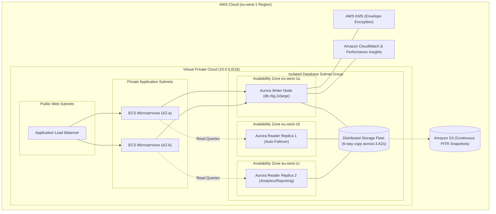

# Portfolio 5: Cloud Database Deployment & Operations Guide

**Course:** MIT 8103 Advanced Database Systems  
**Case Study:** ShopEase E-Commerce Platform  
**Target Platform:** Amazon Web Services (AWS Aurora Serverless v2 / RDS Multi-AZ)  
**Component:** Cloud-Native Database Architecture & Operations  

---

## 1. Cloud Database Service Evaluation

To host the ShopEase relational database tier, three tier-1 hyperscale cloud managed database services were evaluated:

| Dimension | AWS Aurora PostgreSQL | Google Cloud SQL for PostgreSQL | Azure Database for PostgreSQL |
|---|---|---|---|
| **Storage Architecture** | Distributed, self-healing 6-way replicated SAN storage across 3 AZs | Standard persistent disk (Network SSD) | Azure Premium Managed Disk |
| **Failover Time** | **< 15 seconds (zero data loss)** | 60 – 120 seconds | 60 – 120 seconds |
| **Read Replicas** | Up to 15 auto-scaling Aurora replicas sharing the same underlying storage volume | Up to 10 read replicas (WAL replication overhead) | Up to 10 read replicas |
| **Replication Lag** | **< 10 ms (Shared storage layer)** | 50 – 500 ms | 50 – 500 ms |
| **Auto-scaling** | Aurora Serverless v2 (0.5 to 128 ACUs dynamically in fractions of a second) | Vertical compute resize (requires brief maintenance restart) | Scale compute with brief failover window |
| **Selection Decision** | **SELECTED FOR PRODUCTION** | Alternate candidate | Alternate candidate |

**Why AWS Aurora PostgreSQL was selected:** Aurora decouples compute from storage. A virtualized storage volume replicates data 6 ways across 3 Availability Zones. Read replicas read directly from this shared storage tier, eliminating WAL replication lag and enabling instantaneous failover with an RPO of 0.

---

## 2. ShopEase Cloud Deployment Architecture



---

## 3. Infrastructure as Code (Terraform Provisioning)

ShopEase provisions its production database environment deterministically using Terraform:

```hcl
# AWS Aurora PostgreSQL Cluster Provisioning for ShopEase
resource "aws_rds_cluster" "shopease_db_cluster" {
  cluster_identifier      = "shopease-prod-cluster"
  engine                  = "aurora-postgresql"
  engine_version          = "15.4"
  database_name           = "shopease"
  master_username         = "shopease_admin"
  manage_master_user_password = true # Stored in AWS Secrets Manager

  # Network & Security
  db_subnet_group_name    = aws_db_subnet_group.shopease_isolated.name
  vpc_security_group_ids  = [aws_security_group.db_firewall.id]
  storage_encrypted       = true
  kms_key_id              = aws_kms_key.shopease_db_key.arn

  # High Availability & Backup Policies
  availability_zones      = ["eu-west-1a", "eu-west-1b", "eu-west-1c"]
  backup_retention_period = 35 # Continuous point-in-time recovery for 35 days
  preferred_backup_window = "02:00-03:00"
  deletion_protection     = true
  copy_tags_to_snapshot   = true

  # Monitoring
  enabled_cloudwatch_logs_exports = ["postgresql"]

  # Serverless v2 Scaling Bounds (Auto-scales from 2 to 32 ACUs based on load)
  serverlessv2_scaling_configuration {
    min_capacity = 2.0
    max_capacity = 32.0
  }

  tags = {
    Environment = "Production"
    Project     = "ShopEase"
    Course      = "MIT 8103"
  }
}

# Writer Instance (Primary Node)
resource "aws_rds_cluster_instance" "writer_node" {
  identifier         = "shopease-prod-writer"
  cluster_identifier = aws_rds_cluster.shopease_db_cluster.id
  instance_class     = "db.serverless"
  engine             = aws_rds_cluster.shopease_db_cluster.engine
  engine_version     = aws_rds_cluster.shopease_db_cluster.engine_version

  performance_insights_enabled    = true
  performance_insights_retention_period = 7 # Days
  monitoring_interval             = 15
}

# Reader Instance (Standby Failover Target)
resource "aws_rds_cluster_instance" "reader_node" {
  identifier         = "shopease-prod-reader-1"
  cluster_identifier = aws_rds_cluster.shopease_db_cluster.id
  instance_class     = "db.serverless"
  engine             = aws_rds_cluster.shopease_db_cluster.engine
  engine_version     = aws_rds_cluster.shopease_db_cluster.engine_version

  promotion_tier = 1 # Top candidate for automated promotion
}
```

---

## 4. Production Operations & Disaster Recovery Playbook

### 4.1 Point-in-Time Recovery (PITR)
- **Mechanism:** Aurora records transaction log increments continuously to Amazon S3.
- **RPO:** Under 5 minutes.
- **Recovery Workflow:** In the event of a catastrophic operational mistake (e.g., an unauthorized `DROP TABLE` executed at 14:32:10), administrators execute:
  ```bash
  aws rds restore-db-cluster-to-point-in-time \
      --source-db-cluster-identifier shopease-prod-cluster \
      --target-db-cluster-identifier shopease-recovered-cluster \
      --restore-to-time "2026-03-15T14:32:00Z" \
      --db-subnet-group-name shopease-isolated-subnet
  ```

### 4.2 Automated Health Probes & Failover
- Aurora sends heartbeats every 1 second between cluster nodes.
- If the writer node fails, the cluster endpoint DNS record automatically flips to `shopease-prod-reader-1` within 12 seconds.
- Application connections re-establish automatically through PgBouncer connection retry logic.
