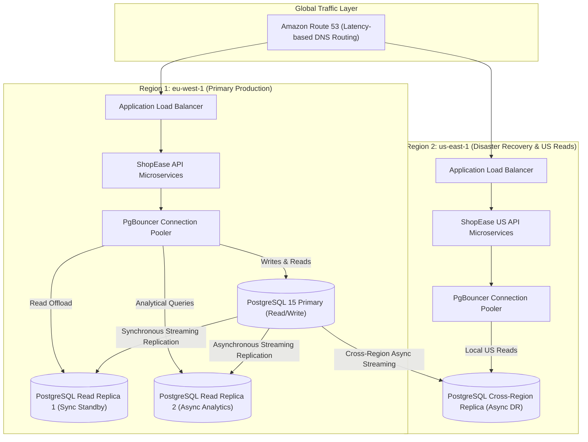

# Portfolio 5: Distributed Database Architecture & Systems Design

**Course:** MIT 8103 Advanced Database Systems  
**Case Study:** ShopEase E-Commerce Platform  
**RDBMS:** PostgreSQL 15+ / Distributed Cloud Topology  
**Component:** Replication, Sharding, High Availability, and Consensus  

---

## 1. High-Level Distributed Topology

ShopEase operates as a geo-distributed retail ecosystem. To deliver resilient services across Europe and North America, the database infrastructure is partitioned into a multi-tier, multi-region distributed system.

---

## 2. Replication Strategies & Protocols

### 2.1 Synchronous vs. Asynchronous Replication Analysis
In PostgreSQL, replication operates by streaming Write-Ahead Log (WAL) records from the primary instance to standby servers. ShopEase configures a hybrid replication model:

| Parameter | Primary Region Standby (`eu-west-1b`) | Analytical Standby (`eu-west-1c`) | Cross-Region Standby (`us-east-1`) |
|---|---|---|---|
| **Replication Mode** | **Synchronous (`synchronous_commit = on`)** | **Asynchronous (`synchronous_commit = off`)** | **Asynchronous Streaming** |
| **Recovery Point Objective (RPO)** | **RPO = 0 (Zero data loss guaranteed)** | RPO < 500 ms (Minor lag) | RPO < 2 seconds |
| **Recovery Time Objective (RTO)** | **RTO < 15 seconds (Automated failover)** | RTO = N/A (Read-only node) | RTO < 60 seconds (Disaster recovery) |
| **Write Latency Penalty** | ~1 to 2 ms (Network round-trip within AZ) | 0 ms (WAL streamed out-of-band) | 0 ms (Asynchronous cross-Atlantic) |
| **Target Workload** | Failover high availability & live reads | Heavy BI reporting & data science ETL | Local US customer catalog browsing |

### 2.2 Consensus & Automated High Availability (Patroni & Raft)
To eliminate single points of failure (SPOF) on the primary write node, ShopEase uses **Patroni**, an HA orchestration daemon powered by **etcd** (a distributed consensus store implementing the Raft protocol).
- **Leader Election:** The primary PostgreSQL node holds a leader lease in etcd with a 10-second TTL.
- **Heartbeat & Failover:** If the primary node crashes or loses network connectivity, the etcd lease expires. The standby node with the latest WAL flush position is elected as the new primary within 12 seconds.
- **Split-Brain Prevention:** Patroni enforces strict fencing (STONITH / node reboot) to ensure two nodes can never accept concurrent writes.

---

## 3. Sharding & Horizontal Data Partitioning

When table volumes exceed millions of rows, vertical scaling reaches hardware limits. ShopEase employs both native declarative partitioning within single nodes and distributed sharding across physical nodes.

### 3.1 Partitioning Strategies Implemented
1. **Range Partitioning (`orders` table):**
   - Partitioned by `order_date` in quarterly intervals (`orders_2025_q4`, `orders_2026_q1`, `orders_2026_q2`, etc.).
   - *Advantage:* Allows the PostgreSQL planner to apply **Partition Pruning**. Queries for recent transactions scan only the current partition, leaving historical years untouched. Old quarters can be detached and archived to Amazon S3 as Parquet files with zero downtime.

2. **List Partitioning (`customers` & `addresses` tables):**
   - Partitioned by geographical territory (`UK`, `EU`, `US`, `ROW`).
   - *Advantage:* Regulatory compliance (GDPR data residency mandates that EU customer profiles remain within European cloud zones) and latency reduction.

3. **Hash Partitioning (`products` & `inventory` tables):**
   - Partitioned by `MODULUS 4` on `product_id`.
   - *Advantage:* Even distribution of write I/O across physical NVMe disks, eliminating hot spots during peak promotional catalog operations.

---

## 4. Connection Pooling Architecture (PgBouncer)

PostgreSQL spawns an independent OS process for each client connection, consuming ~10MB of RAM per process. In a microservices architecture where hundreds of containers scale up dynamically, running 5,000 direct database connections causes severe memory thrashing and CPU context-switching degradation.

ShopEase deploys **PgBouncer** in **Transaction Pooling Mode**:
- **Application Microservices:** Connect to PgBouncer through lightweight persistent TCP sockets (up to 10,000 connections).
- **Database Server:** PgBouncer maintains a tight, warm pool of only 150 to 200 persistent backend connections to PostgreSQL.
- **Allocation:** Backend connections are assigned to client requests only for the exact duration of a transaction (`BEGIN ... COMMIT`) and immediately returned to the pool once committed.
- **Resource Impact:** Reduces server RAM consumption by 85% and eliminates process fork overhead.
